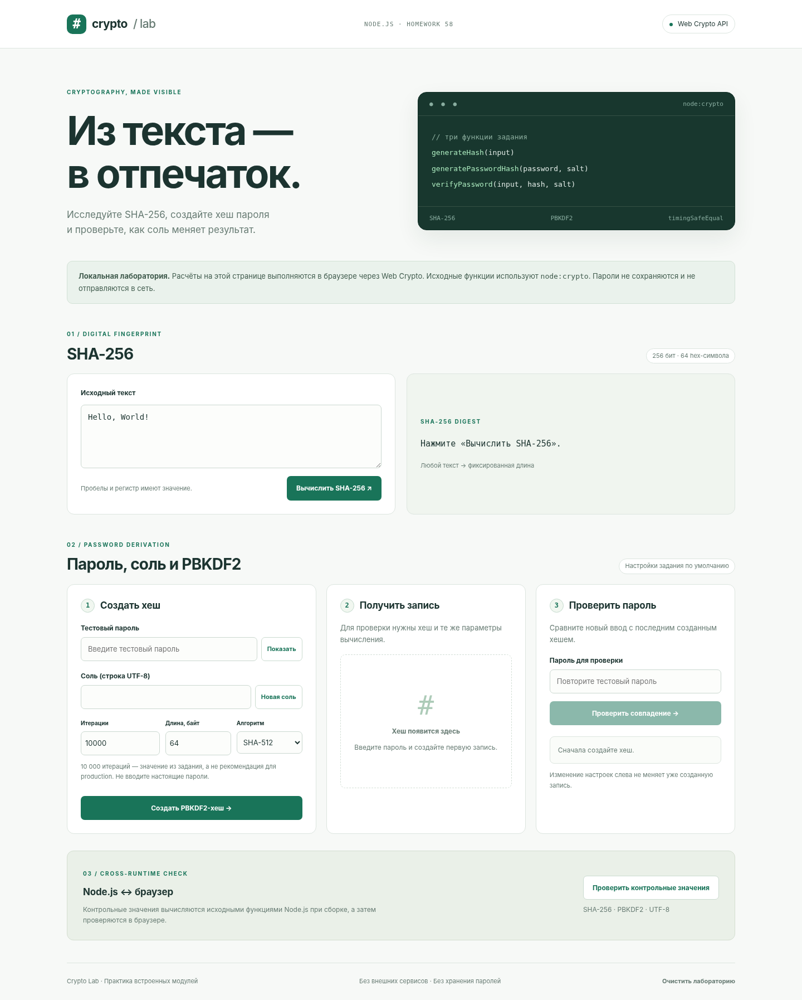

# HW 58 · Crypto Lab

Три криптографические функции на `node:crypto`: SHA-256, PBKDF2-хеш пароля и проверка пароля. Дополнительно: CLI и интерактивная браузерная лаборатория для GitHub Pages. Runtime-зависимостей нет.



## Запуск в Node.js

Node.js 24 либо Node.js 22.12+. Из папки проекта:

```bash
code .
npm start
```

CLI выводит SHA-256, случайную соль, PBKDF2-хеш и результаты проверки правильного/неправильного тестового пароля. Установка npm-пакетов не требуется. Соль при каждом запуске новая, поэтому соответствующий PBKDF2-хеш меняется.

## Запуск в браузере

```bash
npm run dev
```

Откройте `http://127.0.0.1:4173/`. Команда собирает статический сайт и запускает локальный preview. После изменения исходников снова выполните сборку. Остановка — Ctrl+C.

Отдельная сборка и другой порт:

```bash
npm run build
npm run preview -- --port 4174
```

В браузере используются `crypto.subtle.digest`, `importKey` и `deriveBits`. Нативный модуль `node:crypto` не выдаётся за браузерный код. Все пользовательские расчёты выполняются локально; пароли не передаются в сеть, не записываются в localStorage/sessionStorage и не включаются в копируемую запись. HTTPS GitHub Pages и localhost поддерживают безопасный контекст Web Crypto.

Кнопка контрольных значений сверяет браузерные результаты с `dist/vectors.json`, вычисленным исходными Node.js-функциями при сборке. Она делает только GET-запрос за публичными тестовыми примерами.

## API

```js
import { randomBytes } from 'node:crypto'
import { generateHash, generatePasswordHash, verifyPassword } from './src/main.js'

const digest = generateHash('Hello, World!')
const salt = randomBytes(16).toString('hex')
const hash = generatePasswordHash('demo-password', salt)
const correct = verifyPassword('demo-password', hash, salt)
const incorrect = verifyPassword('other-password', hash, salt)
console.log({ digest, salt, hash, correct, incorrect })
```

### generateHash(input)

Принимает строку, кодирует её в UTF-8 и возвращает SHA-256: 64 lowercase hex-символа. Пустая строка допустима; другие типы вызывают `TypeError`. Строка не обрезается и не нормализуется: пробелы, регистр и Unicode-представление влияют на результат.

### generatePasswordHash(password, salt, iterations = 10000, keylen = 64, digest = 'sha512')

Возвращает PBKDF2-хеш как hex-строку длиной `keylen * 2`. Пароль и соль должны быть строками. `keylen` — положительное целое; нулевая длина запрещена. Ошибки iterations/digest обрабатывает встроенный `pbkdf2Sync` и передаёт вызывающему коду. Синхронный контракт сохранён по заданию.

Соль вида `randomBytes(16).toString('hex')` содержит 16 случайных байт, представленных 32 символами. В PBKDF2 передаётся сама строка UTF-8, а не результат обратного декодирования hex. Браузер использует то же соглашение.

### verifyPassword(inputPassword, storedHash, salt, iterations = 10000, keylen = 64, digest = 'sha512')

Повторно вычисляет PBKDF2 с теми же параметрами и сравнивает равные по длине буферы через `timingSafeEqual`. Возвращает `true` только при совпадении. Неправильный пароль или соль дают `false`. Некорректный тип/формат/длина storedHash, а также недопустимая длина ключа дают `false` до сравнения. Для корректного по формату хеша ошибки типа пароля или вычислительных параметров передаются из `generatePasswordHash`. Hex в верхнем регистре допустим, поскольку кодирует те же байты.

## Границы демонстрации

**10 000 итераций — требование учебного задания, не рекомендация для production.** Рабочий коэффициент необходимо подбирать под актуальные требования и оборудование. Соль должна быть случайной и уникальной. SHA-256 сам по себе не является алгоритмом безопасного хранения паролей. Хеширование не является обратимым шифрованием.

`pbkdf2Sync` блокирует поток выполнения на время вычисления. Для нагруженного сервера нужен асинхронный `pbkdf2` или другая подходящая архитектура. `timingSafeEqual` защищает конкретное сравнение байтов и не гарантирует постоянное время выполнения всего приложения.

Браузерный интерфейс ограничен 1–1 000 000 итерациями, 1–128 байтами и SHA-256/SHA-512, чтобы не позволять неограниченные вычисления. Эти интерфейсные ограничения не меняют контракт исходной Node.js-функции. Браузерное сравнение результата — демонстрация, не серверная аутентификация. Вводите только тестовые пароли.

## Проверки

Без внешних пакетов:

```bash
npm run test:native
npm run build
```

Исходные тесты и браузерные сценарии:

```bash
npm install
npm run check
npm run test:coverage
npx playwright install chromium
npm run test:browser
npm run test:report
```

`npm run check` проверяет синтаксис/JSON, выполняет node:test и исходные Vitest-тесты, затем собирает сайт. `npm run test:browser` проверяет сайт под вложенным путём `/repository-check/` и сохраняет снимки в `reports`. Скрипт самостоятельно запускает preview на свободном порту.

`npm run test:report` сохраняет реальный вывод исходных тестов, HTML-отчёт и скриншот при доступном Chromium. `npm run test:report:native` создаёт отчёт нативных тестов. Текущие подтверждённые результаты и ограничения: [VERIFICATION.md](docs/VERIFICATION.md).

## GitHub Pages

Проект публикуется независимо от работы 57. Включите **Settings → Pages → Source → GitHub Actions** и запустите workflow из `.github/workflows/pages.yml`. Все ссылки относительные; имя будущего репозитория менять в коде не нужно.

Демо: после публикации укажите здесь фактический адрес `https://USERNAME.github.io/REPOSITORY/`.

Полная инструкция: [PUBLISHING.md](docs/PUBLISHING.md).

## Структура

`src/main.js` содержит исходное техническое задание и три реализованные функции. Файлы `src/__test__` не изменены. `tests` — дополнительные нативные тесты, включая сравнение с Web Crypto в Node.js. `web` — браузерная лаборатория, `scripts/demo.mjs` — CLI, `scripts/build.mjs` — сборка и вычисление контрольных значений.

Источники и отделение требований задания от дополнений: [SOURCES.md](docs/SOURCES.md).
